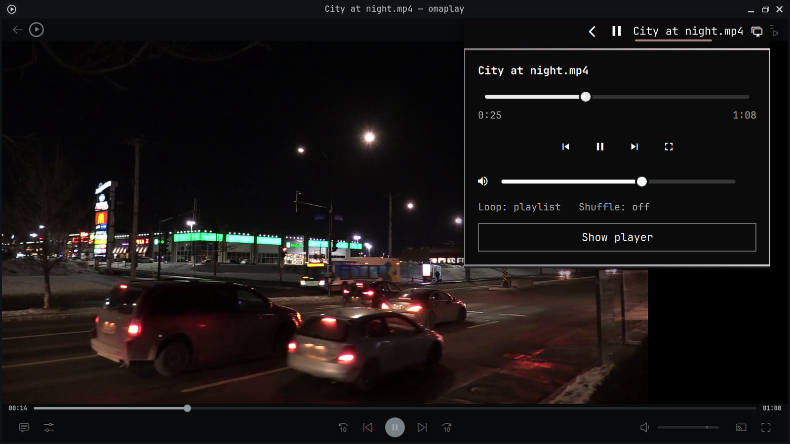

# omaplay for the Omarchy bar

A bar widget and keyboard-friendly mini player for [omaplay](https://github.com/T3-Venture-Labs-Limited/omaplay), the
Omarchy-themed media player based on VLC.



- The bar shows what omaplay is playing; click for the mini player, middle-click to pause.
- Mini player: title, seek bar, previous / play / next / fullscreen, volume, loop and shuffle state, and "Show player".
- Keybinding targets for play/pause, next, previous, volume and the panel.
- Follows your Omarchy theme like the built-in widgets.

It talks to omaplay only over MPRIS. It never plays or decodes anything inside the shell, and it ignores every other
player, including the official VLC.

## Requirements

- Omarchy 4 (Quattro).
- **The omaplay player.** This plugin does nothing without it. Install it first; see the
  [omaplay README](https://github.com/T3-Venture-Labs-Limited/omaplay#install). omaplay is experimental.

## Install

```bash
omarchy plugin add https://github.com/T3-Venture-Labs-Limited/omaplay-plugin.git --enable
```

The widget appears on the right of the bar. Move it with Omarchy's bar settings.

## Keybindings

The plugin registers the IPC target `omaplay`:

| Command | Effect |
|---|---|
| `omarchy-shell omaplay togglePanel` | open or close the mini player |
| `omarchy-shell omaplay playPause` | play or pause |
| `omarchy-shell omaplay next` / `previous` | next or previous item |
| `omarchy-shell omaplay volumeUp` / `volumeDown` | omaplay's own volume, in 5% steps |
| `omarchy-shell omaplay seek 10` / `seek -10` | jump forward or back by that many seconds |
| `omarchy-shell omaplay status` | one line of text, e.g. `playing: Night street.mp4 [0:52/1:08]` |

Each returns `unavailable` while omaplay is not running. For example, in `~/.config/hypr/bindings.lua`:

```lua
o.bind("SUPER + SHIFT + V", "omaplay mini player", "omarchy-shell -q omaplay togglePanel")
o.bind("SUPER + SHIFT + ]", "omaplay volume up", "omarchy-shell -q omaplay volumeUp")
o.bind("SUPER + SHIFT + [", "omaplay volume down", "omarchy-shell -q omaplay volumeDown")
o.bind("SUPER + SHIFT + period", "omaplay forward 10 s", "omarchy-shell -q omaplay seek 10")
```

Then run `hyprctl reload` and check `hyprctl configerrors`.

## Settings

In the bar widget settings:

- **Maximum title width** in pixels (0 shows only the icon).
- **Hide when omaplay is not running.**

## Mini player keys

Arrows move between the seek bar, transport buttons, volume and "Show player"; Left/Right adjust a slider (5 s on the
seek bar, 5% on the volume); Enter activates;
Space or `k` play/pause, `n` next, `p` previous, `f` fullscreen, `o` show the player; Esc closes.

## Remove

```bash
omarchy plugin remove io.github.t3-venture-labs-limited.omaplay
```

Removing the plugin does not touch the omaplay player. Remove that with `sudo pacman -R omaplay` (or your AUR helper).

## Privacy and safety

Titles and file names are shown as plain text, never as rich text. Artwork is loaded only from local `file://` URLs, so the
shell never fetches anything from the network. There is no network access at all.

## License

MIT. omaplay itself is GPL-2.0-or-later and is based on VLC by VideoLAN. omaplay is an independent project and is not
affiliated with or endorsed by VideoLAN. VLC is a trademark of VideoLAN.
